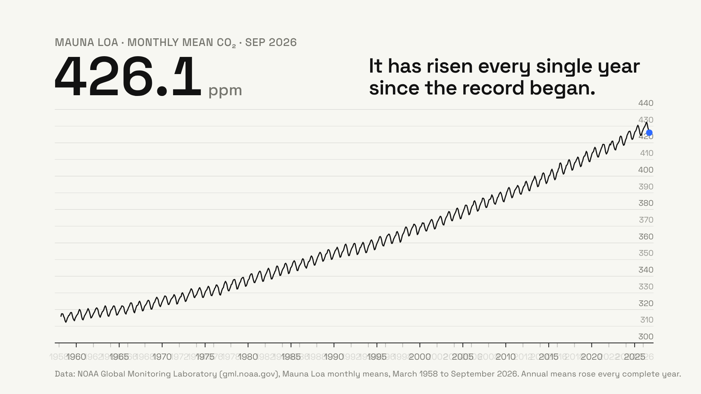
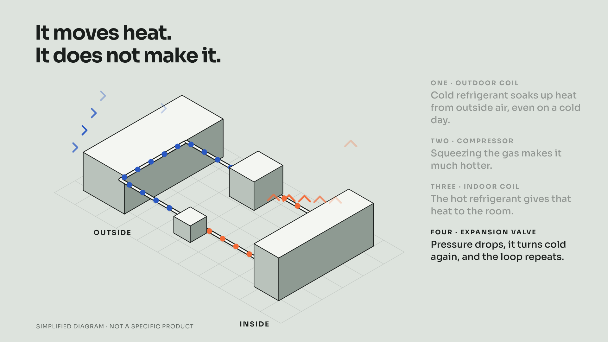
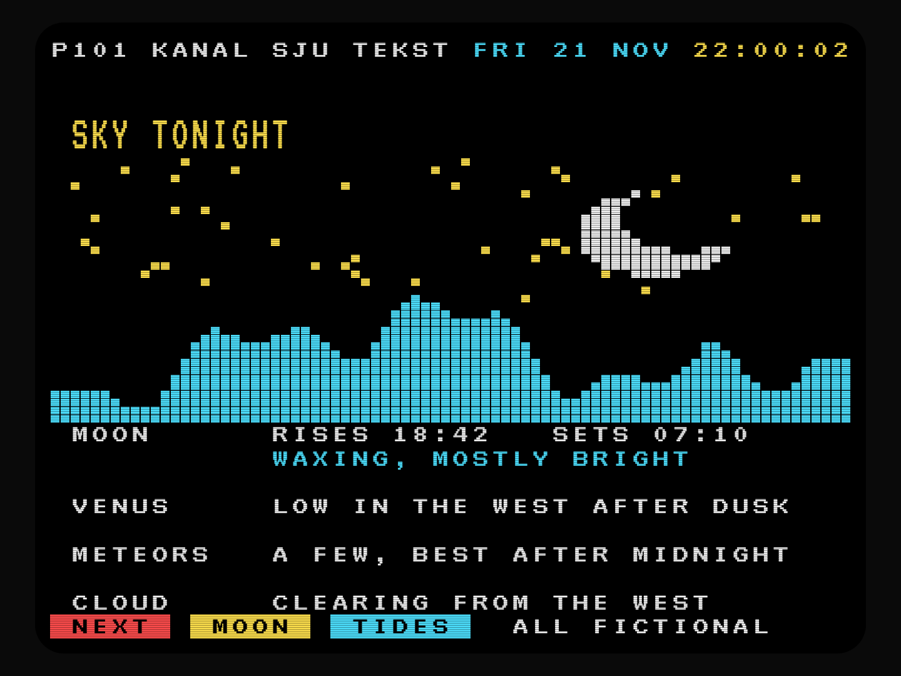
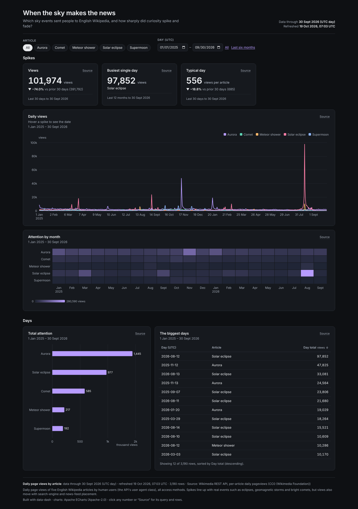

# skill-examples

Twenty showcase examples for two agent skills:

- **[data-dash](https://github.com/venthewise/data-dash)**: a YAML spec plus a data snapshot builds one self-contained, offline HTML dashboard (Apache ECharts inlined) with desktop and mobile screenshots and a quality `check`.
- **[frame-motion](https://github.com/venthewise/frame-motion)**: a seeded, deterministic HTML scene renders frame by frame to MP4, with contact sheets, posters, and `determinism`, `pops` (beat-sync) and `loop` checks.

Every data-dash example uses real open data (source, licence and pull date are in each snapshot and README), except `10`, which is labelled EXAMPLE DATA. Every brand, place and festival in the frame-motion pieces is fictional.

## frame-motion

Click a poster to play the MP4; the title opens the folder (scene, README, contact sheet).

<table>
<tr>
<td align="center" valign="top" width="20%"><a href="frame-motion/01-one-line/one-line.mp4"></a><br><a href="frame-motion/01-one-line"><b>01-one-line</b></a><br><sub>16:9 · 8 s</sub><br><sub>One SVG line draws a sun, a ridge, a seismograph, a horizon</sub></td>
<td align="center" valign="top" width="20%"><a href="frame-motion/02-galton-board/galton-board.mp4"></a><br><a href="frame-motion/02-galton-board"><b>02-galton-board</b></a><br><sub>16:9 · 8 s</sub><br><sub>Seeded canvas physics: 400 beads stack into a bell curve</sub></td>
<td align="center" valign="top" width="20%"><a href="frame-motion/03-rising-contours/rising-contours.mp4"></a><br><a href="frame-motion/03-rising-contours"><b>03-rising-contours</b></a><br><sub>2.39:1 · 8 s</sub><br><sub>WebGL2 topographic shader; sea level steps on the beat</sub></td>
<td align="center" valign="top" width="20%"><a href="frame-motion/04-kolm-social-ad/kolm-social-ad.mp4"></a><br><a href="frame-motion/04-kolm-social-ad"><b>04-kolm-social-ad</b></a><br><sub>9:16 · 8 s · sound</sub><br><sub>Vertical ad for a fictional cold brew, Web Audio score at −14 LUFS</sub></td>
<td align="center" valign="top" width="20%"><a href="frame-motion/05-keeling-chart-story/keeling-chart-story.mp4"></a><br><a href="frame-motion/05-keeling-chart-story"><b>05-keeling-chart-story</b></a><br><sub>16:9 · 10 s</sub><br><sub>Real NOAA CO₂ data as a kinetic chart with a log zoom</sub></td>
</tr>
<tr>
<td align="center" valign="top" width="20%"><a href="frame-motion/06-heat-pump-isometric/heat-pump-isometric.mp4"></a><br><a href="frame-motion/06-heat-pump-isometric"><b>06-heat-pump-isometric</b></a><br><sub>16:9 · 10 s</sub><br><sub>Isometric explainer of the heat-pump cycle</sub></td>
<td align="center" valign="top" width="20%"><a href="frame-motion/07-truchet-loop/truchet-loop.mp4"></a><br><a href="frame-motion/07-truchet-loop"><b>07-truchet-loop</b></a><br><sub>1:1 · 6 s · seamless loop</sub><br><sub>Truchet tiles that rotate in waves and loop perfectly</sub></td>
<td align="center" valign="top" width="20%"><a href="frame-motion/08-teletext-sky/teletext-sky.mp4"></a><br><a href="frame-motion/08-teletext-sky"><b>08-teletext-sky</b></a><br><sub>4:3 · 8 s</sub><br><sub>A fictional teletext sky page, mosaic graphics and all</sub></td>
<td align="center" valign="top" width="20%"><a href="frame-motion/09-night-ferry-route/night-ferry-route.mp4"></a><br><a href="frame-motion/09-night-ferry-route"><b>09-night-ferry-route</b></a><br><sub>16:9 · 10 s</sub><br><sub>Night ferry route across fictional islands, map animation</sub></td>
<td align="center" valign="top" width="20%"><a href="frame-motion/10-slow-poster/slow-poster.mp4"></a><br><a href="frame-motion/10-slow-poster"><b>10-slow-poster</b></a><br><sub>4:5 · 9 s</sub><br><sub>Bodoni poster for a fictional festival; weight grows as letters rise</sub></td>
</tr>
</table>

## data-dash

Click a screenshot to open the example folder; `index.html` inside is the complete dashboard (download it and open it locally; it works offline).

<table>
<tr>
<td align="center" valign="top" width="50%"><a href="data-dash/01-keeling-curve"></a><br><b>01-keeling-curve</b>: The Keeling Curve, month by month<br><sub>NOAA Mauna Loa CO₂: level, growth, seasonal cycle</sub></td>
<td align="center" valign="top" width="50%"><a href="data-dash/02-warming-stripes-heatmap"></a><br><b>02-warming-stripes-heatmap</b>: Every month since the jet age, warmer<br><sub>NASA GISTEMP anomalies as a month × year heatmap</sub></td>
</tr>
<tr>
<td align="center" valign="top" width="50%"><a href="data-dash/03-uk-grid-mix"></a><br><b>03-uk-grid-mix</b>: A month on the Great Britain grid<br><sub>NESO half-hourly generation mix and carbon intensity</sub></td>
<td align="center" valign="top" width="50%"><a href="data-dash/04-wealth-and-longevity"></a><br><b>04-wealth-and-longevity</b>: Wealth and longevity<br><sub>World Bank GDP per person vs life expectancy, with outliers</sub></td>
</tr>
<tr>
<td align="center" valign="top" width="50%"><a href="data-dash/05-fireballs"></a><br><b>05-fireballs</b>: Fireballs over Earth<br><sub>NASA/JPL CNEOS bolides: energy, altitude, latitude</sub></td>
<td align="center" valign="top" width="50%"><a href="data-dash/06-near-earth-flybys"></a><br><b>06-near-earth-flybys</b>: Near-Earth flybys<br><sub>JPL close approaches inside one lunar distance</sub></td>
</tr>
<tr>
<td align="center" valign="top" width="50%"><a href="data-dash/07-five-cities-one-year"></a><br><b>07-five-cities-one-year</b>: Five cities, one year of weather<br><sub>Open-Meteo ERA5 for Reykjavík, Cairo, Singapore, Buenos Aires, Anchorage</sub></td>
<td align="center" valign="top" width="50%"><a href="data-dash/08-sky-events-on-wikipedia"></a><br><b>08-sky-events-on-wikipedia</b>: When the sky makes the news<br><sub>Wikipedia pageviews around eclipses, comets and aurorae</sub></td>
</tr>
<tr>
<td align="center" valign="top" width="50%"><a href="data-dash/09-exoplanet-census"></a><br><b>09-exoplanet-census</b>: The exoplanet census<br><sub>NASA Exoplanet Archive: methods, facilities, worlds</sub></td>
<td align="center" valign="top" width="50%"><a href="data-dash/10-bakery-ops-example"></a><br><b>10-bakery-ops-example</b>: Halde & Rye bakery<br><sub>EXAMPLE DATA: synthetic ops dashboard for a fictional bakery</sub></td>
</tr>
</table>

## Install the skills

Both skills are plain folders (a `SKILL.md` plus scripts) and work with any agent that loads skills from a directory:

```bash
git clone https://github.com/venthewise/data-dash
git clone https://github.com/venthewise/frame-motion
```

Copy or symlink each folder into your agent's skills directory (for example `~/.claude/skills/` or `.agents/skills/`). See each repo's README for requirements: Python 3, DuckDB and Playwright Chromium for data-dash; Python 3, Playwright Chromium and ffmpeg for frame-motion.

## Re-render any example

Clone this repo next to the skills (paths below assume `../data-dash` and `../frame-motion`), then run from the repo root.

**data-dash**: rebuild a dashboard from its committed snapshot, fully offline:

```bash
python3 ../data-dash/scripts/dash.py all data-dash/01-keeling-curve/spec.yaml \
  --outdir data-dash/01-keeling-curve --offline
python3 ../data-dash/scripts/dash.py check data-dash/01-keeling-curve/index.html
```

`all` runs refresh, build, check and export; `check` on its own re-runs the quality rules against a built folder. Drop `--offline` to re-pull fresh data from the source in `spec.yaml`. Each example README gives its exact command.

**frame-motion**: scenes are pure functions of time, so a re-render is byte-for-byte reproducible frame by frame:

```bash
cd frame-motion/07-truchet-loop
R=../../../frame-motion/scripts/render.py
python3 $R full scene.html truchet-loop.mp4 --duration 6 --preset 1:1 \
  --fps 30 --sub 3 --shutter 0.5 --crf 22
python3 $R determinism scene.html --times 2.22,4.86 --preset 1:1
python3 $R loop scene.html --duration 6 --fps 30 --preset 1:1
```

Each example README lists its exact render, check and (for `04`) audio commands. The fonts in `frame-motion/fonts/` are local subsets, so no scene touches the network.

## Layout

```
data-dash/NN-name/     spec.yaml · snapshots/ · index.html · desktop.png · mobile.png · README.md
frame-motion/NN-name/  scene.html · <name>.mp4 · poster.png · contact-sheet.png · README.md
frame-motion/fonts/    OFL font subsets (woff2) shared by the scenes
LICENSES/              third-party licence texts
```

## Licence

Code, specs, scenes and renders: MIT (see [LICENSE](LICENSE)). Data, fonts and the embedded Apache ECharts keep their own licences; see [NOTICE](NOTICE) and [LICENSES/](LICENSES).
