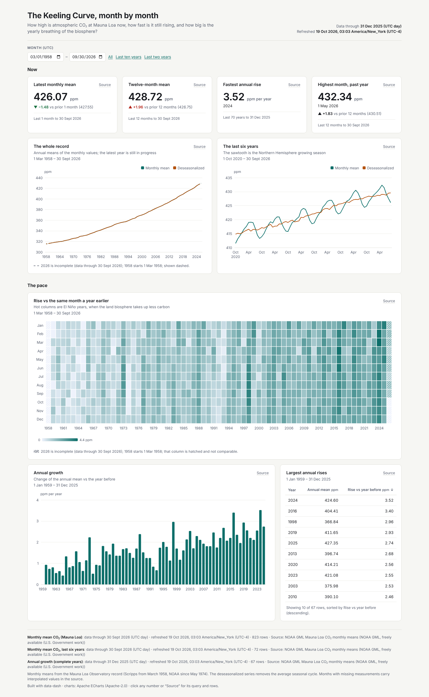
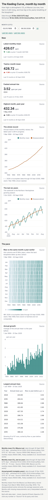

# The Keeling Curve, month by month



**Question:** How high is atmospheric CO₂ at Mauna Loa now, how fast is it still rising, and how big is the seasonal cycle?

| Desktop | Mobile |
|---|---|
| [desktop.png](desktop.png) |  |

Open [`index.html`](index.html) for the interactive version. It is a single offline file, and you can click any number to see its query and rows.

## Data

- **Source:** NOAA Global Monitoring Laboratory, Mauna Loa monthly mean CO₂ (`co2_mm_mlo.csv`) <https://gml.noaa.gov/webdata/ccgg/trends/co2/co2_mm_mlo.csv>
- **Licence:** Freely available U.S. Government work. Please cite Lan, X., Tans, P. and K.W. Thoning, NOAA GML, and Scripps Institution of Oceanography for the pre-1974 record.
- **Snapshot:** snapshots/co2_mm_mlo.json: 823 monthly rows, March 1958 to September 2026.
- **Pulled:** 2026-10-19 06:52 UTC (recorded as `pulled_at` in each snapshot file, with `pulled_from` and the exact query).

## What's interesting

- The monthly mean for September 2026 was 426.07 ppm. The twelve-month mean was 428.72 ppm, up 1.96 ppm on the twelve months before.
- The fastest annual rise in the record was 2024 at +3.52 ppm. The heatmap of rise versus the same month a year earlier picks out El Niño years as dark columns.
- Uses three datasets from one source: the full monthly record, the last six years (so the seasonal sawtooth is readable), and complete calendar years for the growth bars.

## Build

Look: light theme, teal accent; line ×2, heatmap, bar, table, four KPIs.

From the repo root:

```bash
python3 <data-dash skill>/scripts/dash.py all data-dash/01-keeling-curve/spec.yaml --outdir data-dash/01-keeling-curve --offline
```

`all` runs refresh, build, check and export: it rebuilds `index.html` and runs every `check` rule (this example passes with 0 fail and 0 warn), then re-exports `desktop.png` and `mobile.png`. It also writes a PDF and the intermediate `data/` and `.cache/` folders, and the repo ignores all three. The snapshot is the only data input, so rebuilding needs no network.
