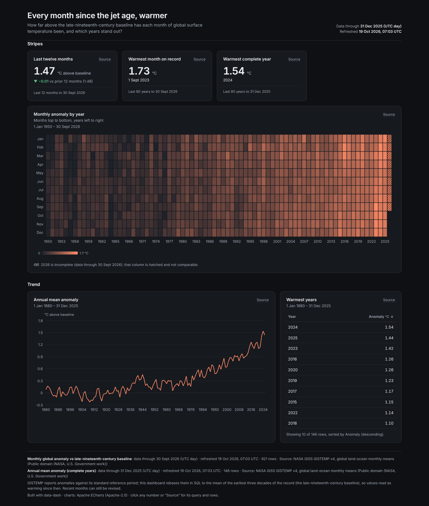
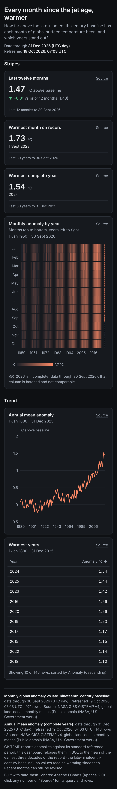

# Every month since the jet age, warmer



**Question:** How far above the late-nineteenth-century baseline has each month of global surface temperature been since 1950, and which years stand out?

| Desktop | Mobile |
|---|---|
| [desktop.png](desktop.png) |  |

Open [`index.html`](index.html) for the interactive version. It is a single offline file, and you can click any number to see its query and rows.

## Data

- **Source:** NASA GISS Surface Temperature Analysis (GISTEMP v4), global land-ocean monthly means <https://data.giss.nasa.gov/gistemp/tabledata_v4/GLB.Ts+dSST.csv>
- **Licence:** Public domain (NASA, U.S. Government work). Cite: GISTEMP Team, NASA Goddard Institute for Space Studies; Lenssen et al. (2019).
- **Snapshot:** snapshots/gistemp_v4_glb.json: the wide year × month table as published, 147 rows. The spec unpivots it and rebases it to the record's first thirty years in SQL.
- **Pulled:** 2026-10-19 06:52 UTC (recorded as `pulled_at` in each snapshot file, with `pulled_from` and the exact query).

## What's interesting

- The twelve months to September 2026 averaged 1.47 °C above the 1880 to 1909 mean. The warmest single month was September 2023 (+1.73 °C), and the warmest complete year was 2024 (+1.54 °C).
- The heatmap is a month-by-month version of warming stripes. Months run top to bottom and years left to right, and the partial current year is hatched.
- The baseline is rebased in SQL, so the snapshot stays exactly as NASA publishes it.

## Build

Look: dark theme, tabs; heatmap, line, table, three KPIs.

From the repo root:

```bash
python3 <data-dash skill>/scripts/dash.py all data-dash/02-warming-stripes-heatmap/spec.yaml --outdir data-dash/02-warming-stripes-heatmap --offline
```

`all` runs refresh, build, check and export: it rebuilds `index.html` and runs every `check` rule (this example passes with 0 fail and 0 warn), then re-exports `desktop.png` and `mobile.png`. It also writes a PDF and the intermediate `data/` and `.cache/` folders, and the repo ignores all three. The snapshot is the only data input, so rebuilding needs no network.
