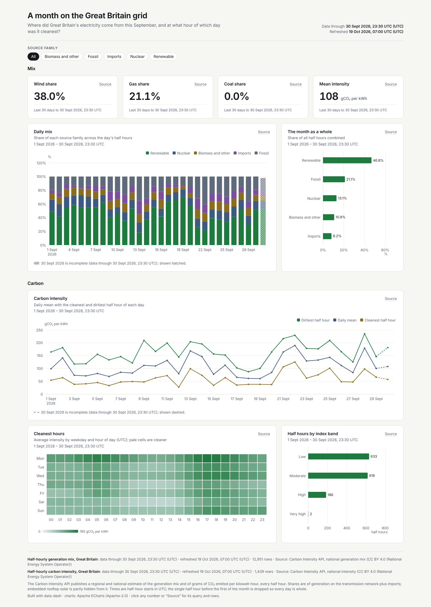
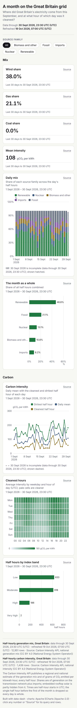

# A month on the Great Britain grid



**Question:** Where did Great Britain's electricity come from in September 2026, and at what hour of which day was it cleanest?

| Desktop | Mobile |
|---|---|
| [desktop.png](desktop.png) |  |

Open [`index.html`](index.html) for the interactive version. It is a single offline file, and you can click any number to see its query and rows.

## Data

- **Source:** Carbon Intensity API (National Energy System Operator), national generation mix and intensity, half-hourly, 1 to 30 September 2026 <https://api.carbonintensity.org.uk/>
- **Licence:** CC BY 4.0. Attribution: National Energy System Operator (NESO) / carbonintensity.org.uk.
- **Snapshot:** snapshots/generation_mix.json (12,960 rows) and snapshots/intensity.json (1,440 rows).
- **Pulled:** 2026-10-19 06:52 UTC (recorded as `pulled_at` in each snapshot file, with `pulled_from` and the exact query).

## What's interesting

- Wind supplied 38.0% of the month's generation and gas 21.1%. Coal rounds to 0.0%, since Great Britain's last coal plant closed in 2024.
- Mean carbon intensity was 108 gCO₂/kWh. The weekday × hour heatmap shows the early-afternoon solar dip and the evening peak.
- Shares are summed as share / 48 per half hour, so the daily stacked bars add up to 100%. The last half hour of the month is missing from the API pull, so the last day is flagged as partial.

## Build

Look: light theme, green accent, tabs; stacked bar, ranked bar, line with daily min/mean/max, heatmap with categorical axes, category filter.

From the repo root:

```bash
python3 <data-dash skill>/scripts/dash.py all data-dash/03-uk-grid-mix/spec.yaml --outdir data-dash/03-uk-grid-mix --offline
```

`all` runs refresh, build, check and export: it rebuilds `index.html` and runs every `check` rule (this example passes with 0 fail and 0 warn), then re-exports `desktop.png` and `mobile.png`. It also writes a PDF and the intermediate `data/` and `.cache/` folders, and the repo ignores all three. The snapshot is the only data input, so rebuilding needs no network.
