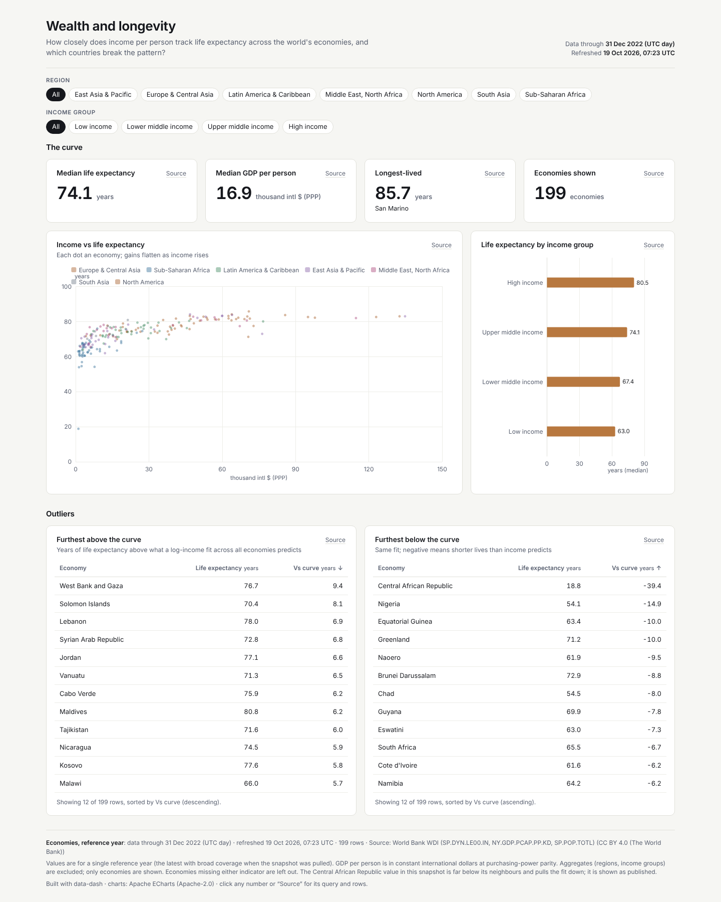
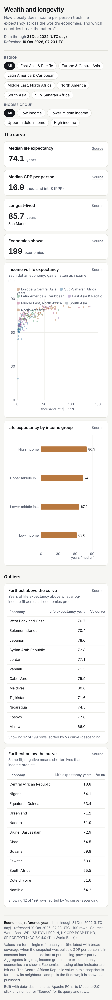

# Wealth and longevity



**Question:** How closely does income per person track life expectancy across the world's economies, and which countries break the pattern?

| Desktop | Mobile |
|---|---|
| [desktop.png](desktop.png) |  |

Open [`index.html`](index.html) for the interactive version. It is a single offline file, and you can click any number to see its query and rows.

## Data

- **Source:** World Bank World Development Indicators: SP.DYN.LE00.IN (life expectancy at birth), NY.GDP.PCAP.PP.KD (GDP per capita, PPP, constant international $), SP.POP.TOTL; reference year 2022; plus country region and income metadata <https://api.worldbank.org/v2/>
- **Licence:** CC BY 4.0, The World Bank.
- **Snapshot:** snapshots/wdi_2022.json: 217 economies. 199 have both indicators.
- **Pulled:** 2026-10-19 06:52 UTC (recorded as `pulled_at` in each snapshot file, with `pulled_from` and the exact query).

## What's interesting

- The median life expectancy is 74.1 years, and the longest-lived economy is San Marino at 85.7 years.
- The two outlier tables use a log-income fit computed in DuckDB (`regr_slope`/`regr_intercept` on ln GDP). West Bank and Gaza, the Solomon Islands and Lebanon sit furthest above the curve, and Nigeria and Equatorial Guinea furthest below.
- The snapshot value for the Central African Republic is implausibly low (18.8 years). It is shown as published and flagged in the footnote, not silently dropped.

## Build

Look: light theme, amber accent; scatter by region, ranked bar with an ordinal palette, two tables, two category filters, explicit `data_through`.

From the repo root:

```bash
python3 <data-dash skill>/scripts/dash.py all data-dash/04-wealth-and-longevity/spec.yaml --outdir data-dash/04-wealth-and-longevity --offline
```

`all` runs refresh, build, check and export: it rebuilds `index.html` and runs every `check` rule (this example passes with 0 fail and 0 warn), then re-exports `desktop.png` and `mobile.png`. It also writes a PDF and the intermediate `data/` and `.cache/` folders, and the repo ignores all three. The snapshot is the only data input, so rebuilding needs no network.
