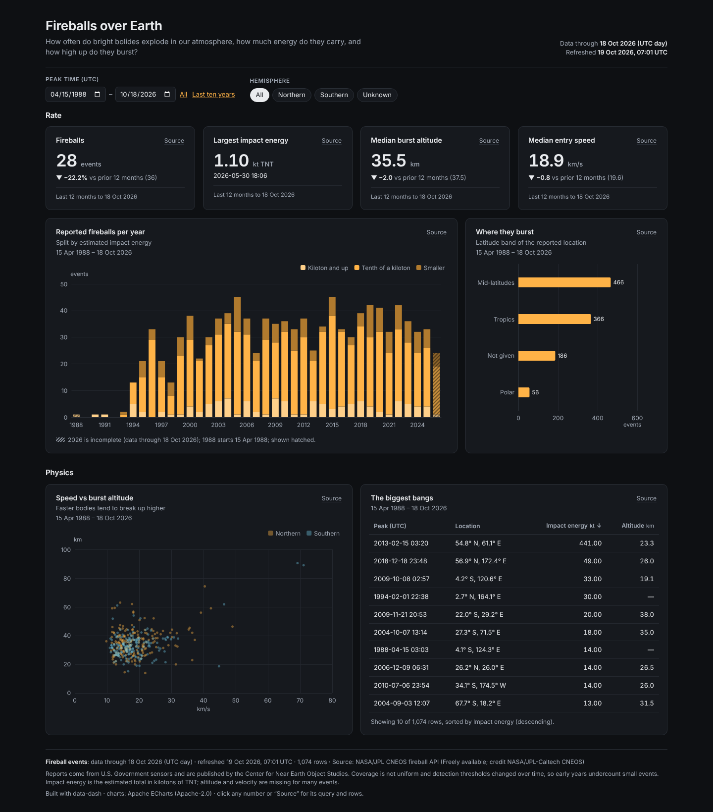
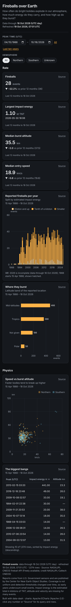

# Fireballs over Earth



**Question:** How often do bright bolides explode in our atmosphere, how much energy do they carry, and how high up do they burst?

| Desktop | Mobile |
|---|---|
| [desktop.png](desktop.png) |  |

Open [`index.html`](index.html) for the interactive version. It is a single offline file, and you can click any number to see its query and rows.

## Data

- **Source:** NASA/JPL Center for Near Earth Object Studies (CNEOS), Fireball and Bolide Data API <https://ssd-api.jpl.nasa.gov/fireball.api>
- **Licence:** Freely available. Credit: NASA/JPL-Caltech, CNEOS. Data from U.S. Government sensors.
- **Snapshot:** snapshots/fireballs.json: 1,074 events, April 1988 to October 2026. The values are strings, as the API returns them.
- **Pulled:** 2026-10-19 06:52 UTC (recorded as `pulled_at` in each snapshot file, with `pulled_from` and the exact query).

## What's interesting

- There were 28 reported fireballs in the twelve months to 18 October 2026, 22% fewer than the twelve months before.
- The biggest event in the table is 15 February 2013 at about 441 kt of total impact energy. That is the Chelyabinsk superbolide.
- Parsing (`try_cast`), hemisphere and latitude bands are all done in the spec's SQL.

## Build

Look: dark theme, amber accent; stacked bar by energy band, ranked bar, scatter, table, date + category filters.

From the repo root:

```bash
python3 <data-dash skill>/scripts/dash.py all data-dash/05-fireballs/spec.yaml --outdir data-dash/05-fireballs --offline
```

`all` runs refresh, build, check and export: it rebuilds `index.html` and runs every `check` rule (this example passes with 0 fail and 0 warn), then re-exports `desktop.png` and `mobile.png`. It also writes a PDF and the intermediate `data/` and `.cache/` folders, and the repo ignores all three. The snapshot is the only data input, so rebuilding needs no network.
