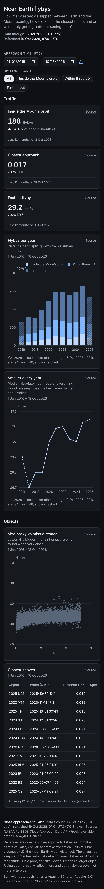

# Near-Earth flybys


**Question:** How many asteroids passed inside the Moon's orbit recently, how close did the closest come, and are we simply getting better at seeing them?

| Desktop | Mobile |
|---|---|
| [desktop.png](desktop.png) |  |

Open [`index.html`](index.html) for the interactive version. It is a single offline file, and you can click any number to see its query and rows.

## Data

- **Source:** NASA/JPL Solar System Dynamics, SBDB Close-Approach Data API (approaches within 0.02 au of Earth, 2016-01-01 to 2026-10-18) <https://ssd-api.jpl.nasa.gov/cad.api>
- **Licence:** Freely available. Credit: NASA/JPL-Caltech, Solar System Dynamics.
- **Snapshot:** snapshots/close_approaches.json: 7,918 close approaches.
- **Pulled:** 2026-10-19 06:52 UTC (recorded as `pulled_at` in each snapshot file, with `pulled_from` and the exact query).

## What's interesting

- 188 flybys came inside the Moon's orbit in the twelve months to 18 October 2026, against 180 the year before.
- The median absolute magnitude of what is found rises over the decade, which means surveys are catching ever smaller objects. That is the "are we just seeing more" answer.
- The very closest entries are tiny objects whose nominal paths came within a few hundred kilometres of the surface or into the atmosphere. Distances are measured from the centre of Earth.

## Build

Look: dark theme, blue accent; stacked bar, line on `y_scale`, scatter with inverted y, table, `allow_terms: [LD]`.

From the repo root:

```bash
python3 <data-dash skill>/scripts/dash.py all data-dash/06-near-earth-flybys/spec.yaml --outdir data-dash/06-near-earth-flybys --offline
```

`all` runs refresh, build, check and export: it rebuilds `index.html` and runs every `check` rule (this example passes with 0 fail and 0 warn), then re-exports `desktop.png` and `mobile.png`. It also writes a PDF and the intermediate `data/` and `.cache/` folders, and the repo ignores all three. The snapshot is the only data input, so rebuilding needs no network.
