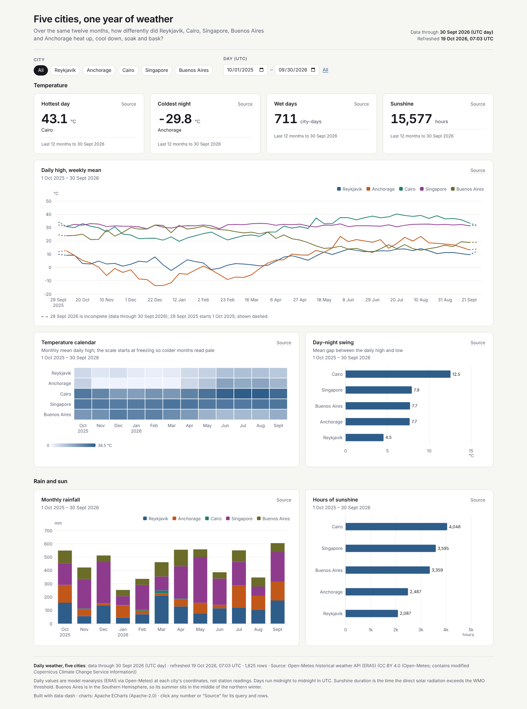
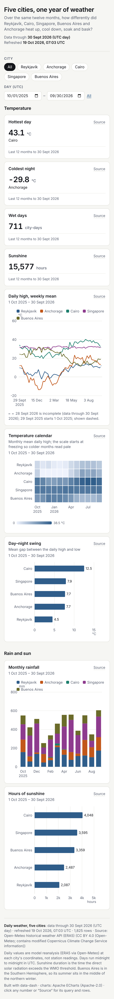

# Five cities, one year of weather



**Question:** Over the same twelve months, how differently did Reykjavík, Cairo, Singapore, Buenos Aires and Anchorage heat up, cool down, soak and bask?

| Desktop | Mobile |
|---|---|
| [desktop.png](desktop.png) |  |

Open [`index.html`](index.html) for the interactive version. It is a single offline file, and you can click any number to see its query and rows.

## Data

- **Source:** Open-Meteo Historical Weather API (ERA5 reanalysis), daily max/min temperature, precipitation and sunshine duration, 1 October 2025 to 30 September 2026 <https://open-meteo.com/en/docs/historical-weather-api>
- **Licence:** CC BY 4.0, Open-Meteo.com. Contains modified Copernicus Climate Change Service information.
- **Snapshot:** snapshots/daily_weather.json: 1,825 city-days.
- **Pulled:** 2026-10-19 06:52 UTC (recorded as `pulled_at` in each snapshot file, with `pulled_from` and the exact query).

## What's interesting

- The hottest day was 43.1 °C in Cairo, and the coldest night was −29.8 °C in Anchorage.
- Cairo logged about 4,050 hours of sunshine, roughly double Reykjavík.
- The weekly-high lines cross over: Buenos Aires peaks in December and January, while the northern cities peak in July. Singapore barely moves.

## Build

Look: light theme, five-series palette; multi-series line, heatmap, stacked bar, two ranked bars.

From the repo root:

```bash
python3 <data-dash skill>/scripts/dash.py all data-dash/07-five-cities-one-year/spec.yaml --outdir data-dash/07-five-cities-one-year --offline
```

`all` runs refresh, build, check and export: it rebuilds `index.html` and runs every `check` rule (this example passes with 0 fail and 0 warn), then re-exports `desktop.png` and `mobile.png`. It also writes a PDF and the intermediate `data/` and `.cache/` folders, and the repo ignores all three. The snapshot is the only data input, so rebuilding needs no network.
