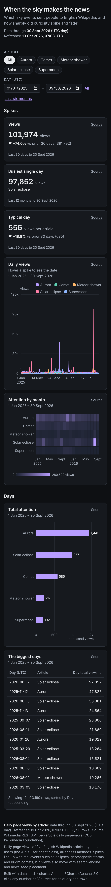

# When the sky makes the news


**Question:** Which sky events sent people to English Wikipedia, and how sharply did curiosity spike and fade?

| Desktop | Mobile |
|---|---|
| [desktop.png](desktop.png) |  |

Open [`index.html`](index.html) for the interactive version. It is a single offline file, and you can click any number to see its query and rows.

## Data

- **Source:** Wikimedia REST API, per-article daily pageviews (en.wikipedia, all access, user agents), 1 January 2025 to 30 September 2026, articles Solar eclipse, Aurora, Comet, Meteor shower, Supermoon <https://wikimedia.org/api/rest_v1/>
- **Licence:** CC0 1.0, Wikimedia Foundation.
- **Snapshot:** snapshots/pageviews.json: 3,190 article-days.
- **Pulled:** 2026-10-19 06:52 UTC (recorded as `pulled_at` in each snapshot file, with `pulled_from` and the exact query).

## What's interesting

- The busiest single day was 12 August 2026 (Solar eclipse, 97,852 views), the day of the total eclipse over Greenland, Iceland and Spain.
- Aurora spikes on 12 November 2025 (47,825 views).
- The spikes decay within days. The monthly heatmap shows how little attention is left between events.

## Build

Look: dark theme, violet accent; multi-series daily line, heatmap, ranked bar in thousands, table.

From the repo root:

```bash
python3 <data-dash skill>/scripts/dash.py all data-dash/08-sky-events-on-wikipedia/spec.yaml --outdir data-dash/08-sky-events-on-wikipedia --offline
```

`all` runs refresh, build, check and export: it rebuilds `index.html` and runs every `check` rule (this example passes with 0 fail and 0 warn), then re-exports `desktop.png` and `mobile.png`. It also writes a PDF and the intermediate `data/` and `.cache/` folders, and the repo ignores all three. The snapshot is the only data input, so rebuilding needs no network.
