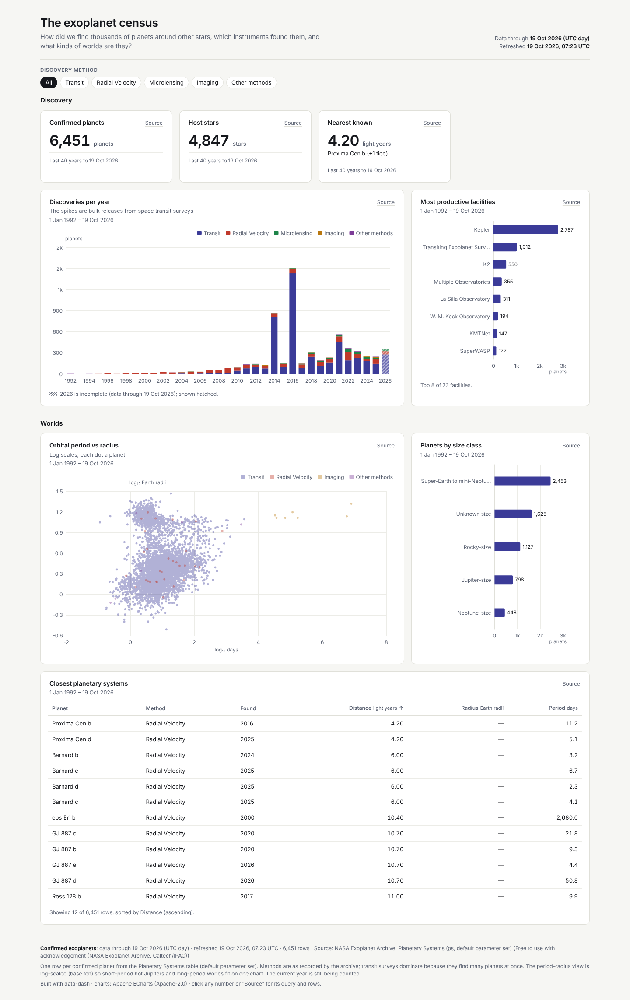
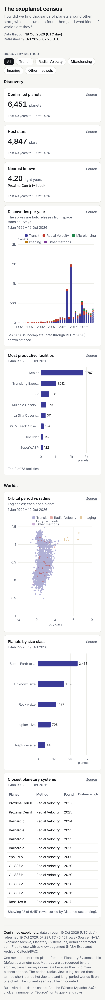

# The exoplanet census



**Question:** How did we find thousands of planets around other stars, which instruments found them, and what kinds of worlds are they?

| Desktop | Mobile |
|---|---|
| [desktop.png](desktop.png) |  |

Open [`index.html`](index.html) for the interactive version. It is a single offline file, and you can click any number to see its query and rows.

## Data

- **Source:** NASA Exoplanet Archive, Planetary Systems table (`ps`, default parameter set), via TAP <https://exoplanetarchive.ipac.caltech.edu/>
- **Licence:** Free to use with acknowledgement: "This research has made use of the NASA Exoplanet Archive, which is operated by the California Institute of Technology, under contract with the National Aeronautics and Space Administration under the Exoplanet Exploration Program."
- **Snapshot:** snapshots/planetary_systems.json: 6,451 confirmed planets.
- **Pulled:** 2026-10-19 06:52 UTC (recorded as `pulled_at` in each snapshot file, with `pulled_from` and the exact query).

## What's interesting

- The snapshot holds 6,451 confirmed planets around 4,847 host stars. The nearest is Proxima Centauri b at 4.20 light years.
- The 2016 spike is the bulk statistical validation of Kepler candidates. Transit dominates every year since.
- The period–radius scatter is log-scaled in SQL (`log10`). The hot-Jupiter clump at short periods stands out, and you can look for the "radius valley" between super-Earths and mini-Neptunes.

## Build

Look: light theme, indigo accent; stacked bar, ranked bar, log-log scatter, size-class bar, table, method filter.

From the repo root:

```bash
python3 <data-dash skill>/scripts/dash.py all data-dash/09-exoplanet-census/spec.yaml --outdir data-dash/09-exoplanet-census --offline
```

`all` runs refresh, build, check and export: it rebuilds `index.html` and runs every `check` rule (this example passes with 0 fail and 0 warn), then re-exports `desktop.png` and `mobile.png`. It also writes a PDF and the intermediate `data/` and `.cache/` folders, and the repo ignores all three. The snapshot is the only data input, so rebuilding needs no network.
