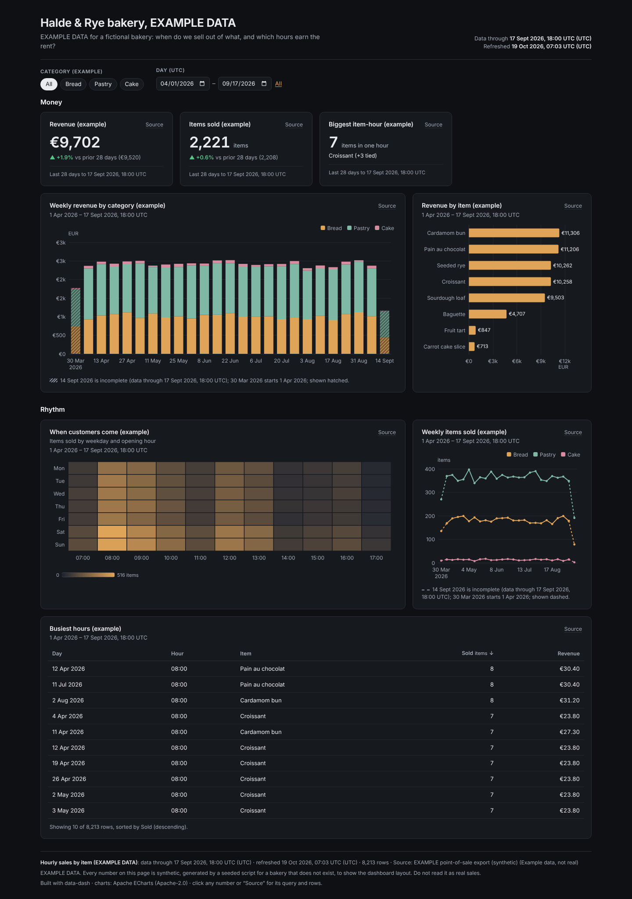
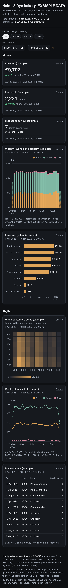

# Halde & Rye bakery (EXAMPLE DATA)



**Question:** For a fictional bakery: when do customers come, which items earn the money, and which hours sell out?

| Desktop | Mobile |
|---|---|
| [desktop.png](desktop.png) |  |

Open [`index.html`](index.html) for the interactive version. It is a single offline file, and you can click any number to see its query and rows.

## Data

- **Source:** EXAMPLE DATA. Seeded synthetic point-of-sale numbers (`random.Random(1912)`) for a bakery that does not exist.
- **Licence:** Not real data; free to reuse with the rest of this repo (MIT).
- **Snapshot:** snapshots/pos_hourly.json: 8,213 item-hours, 1 April to 17 September 2026. It is marked `"example": true` with a note in the file.

## What's interesting

- Every title, the subtitle, the source line and the footnote say EXAMPLE DATA. Use this pattern when you need a layout demo without real numbers.
- The categorical hour × weekday heatmap uses `x_order`/`y_order`. The weekly stacked revenue uses currency formatting, which carries its own unit.
- Partial first and last weeks are hatched automatically from `data_through`.

## Build

Look: dark theme, warm accent, tabs; currency KPIs, stacked bar, ranked bar, heatmap, line, table.

From the repo root:

```bash
python3 <data-dash skill>/scripts/dash.py all data-dash/10-bakery-ops-example/spec.yaml --outdir data-dash/10-bakery-ops-example --offline
```

`all` runs refresh, build, check and export: it rebuilds `index.html` and runs every `check` rule (this example passes with 0 fail and 0 warn), then re-exports `desktop.png` and `mobile.png`. It also writes a PDF and the intermediate `data/` and `.cache/` folders, and the repo ignores all three. The snapshot is the only data input, so rebuilding needs no network.
