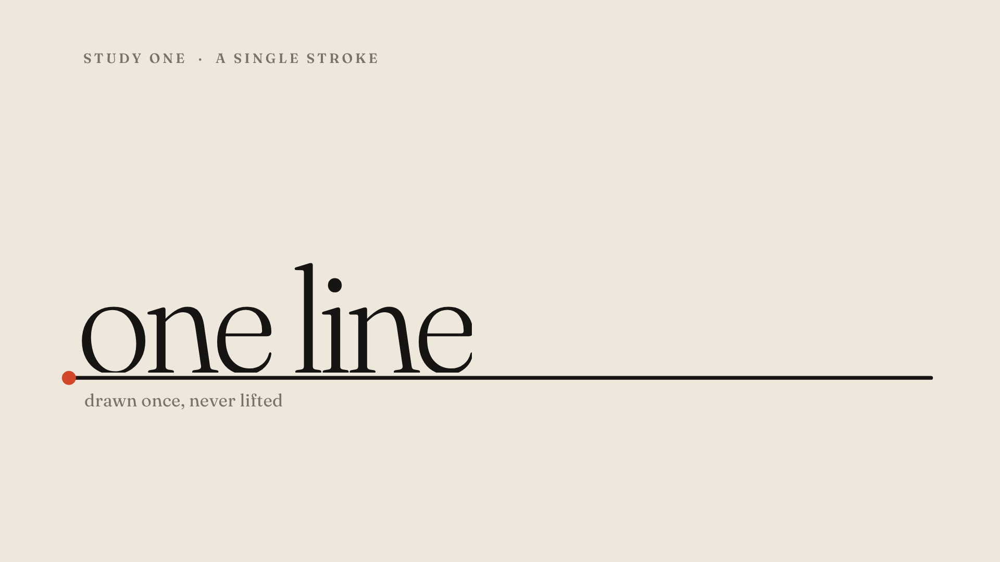
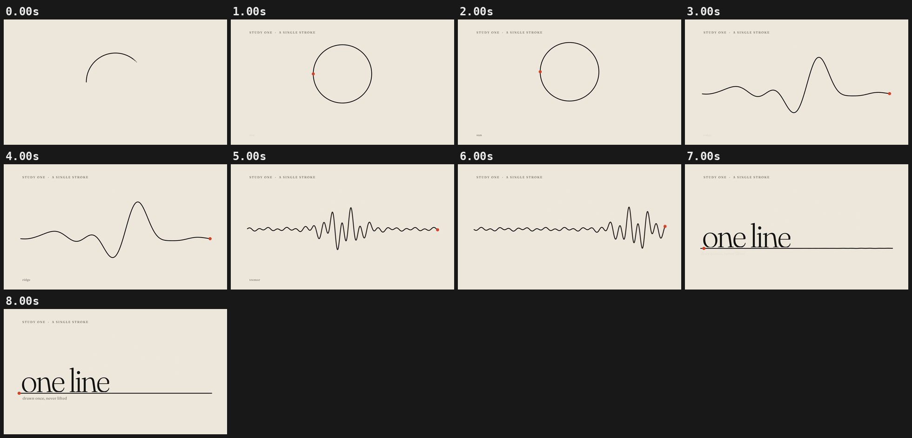

# 01 · ONE LINE

[](one-line.mp4)

**[▶ one-line.mp4](one-line.mp4)** · 1920×1080 · 8 s · 30 fps · 0.4 MB

## Concept

One continuous ink stroke is laid down as a sun, rises, morphs into a mountain ridge, then into a travelling seismograph trace, and finally flattens into the horizon that the title rises out of. The vermilion nib is the pen tip and never leaves the line.

- **Typeface:** Fraunces (SIL OFL 1.1, local `../fonts/` subset)
- **Colours:** paper #EEE8DC, ink #161514, vermilion #D2462A (nib), warm grey
- **Tempo:** 120 BPM (beat = 0.500 s)

## Beat map

| Beat | Time (s) | Event |
|---|---|---|
| b0 | 0.0 | the stroke starts drawing at the left of the sun, nib at the head (hook) |
| b2 | 1.0 | sun closed; it keeps rising (no dead hold) |
| b4 | 2.0 | sun morphs into a ridge, staggered left to right along the line |
| b6 | 3.0 | "ridge" label |
| b8 | 4.0 | ridge morphs into a seismograph trace; the burst travels right |
| b12 | 6.0 | trace collapses onto the horizon (critically damped spring) |
| b12.5 | 6.25 | "one line" rises out of the horizon letter by letter, masked at the line |
| b14 | 7.0 | caption lands; camera push continues to the end |

## Techniques

- SVG `<path>` rebuilt every frame from 420 points. The morph interpolates point lists with equal counts, with a per-point stagger along the path.
- Line drawing is done by emitting only the first *f·N* points plus an interpolated head point (no dash-offset tricks), so the nib sits exactly on the head.
- The ridge is a seeded sum of sines (mulberry32). The seismograph is a closed-form travelling wave with a moving Gaussian envelope.
- The title is masked with `clip-path` exactly at the horizon so the letters grow out of the line.
- Pure `window.seek(t)`: no `Date`, no `requestAnimationFrame`, no timers, no `Math.random`. `window.ready` is set only after the local font has loaded, and the scene works offline from `file://`.

## Contact sheet



## Render

From this folder, with `R=<frame-motion skill>/scripts/render.py`:

```bash
python3 $R full scene.html one-line.mp4 --duration 8 --fps 30 --sub 3 --shutter 0.5 --crf 21
python3 $R sheet one-line.mp4 --every 1 --duration 8 --out contact-sheet.png
python3 $R poster scene.html poster.png --t 7.9
```

Checks:

```bash
python3 $R determinism scene.html --times 2.96,6.48
python3 $R pops one-line.mp4 --bpm 120
```

## Check results

- `determinism`: seek 2.96 -> 6.48 -> 2.96: max diff 0, mean 0.0000 -> PASS (pixel identical)
- `pops`: 0 spike(s), 0 single-frame flash(es) -> clean; beat sync: 0 on a beat, 0 on a half-beat, 0 off-beat (of 0 spikes, tolerance 4 frames)
