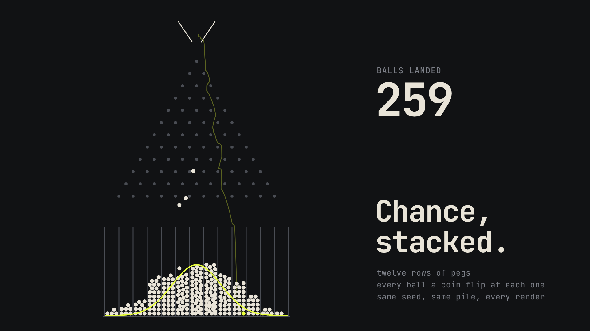
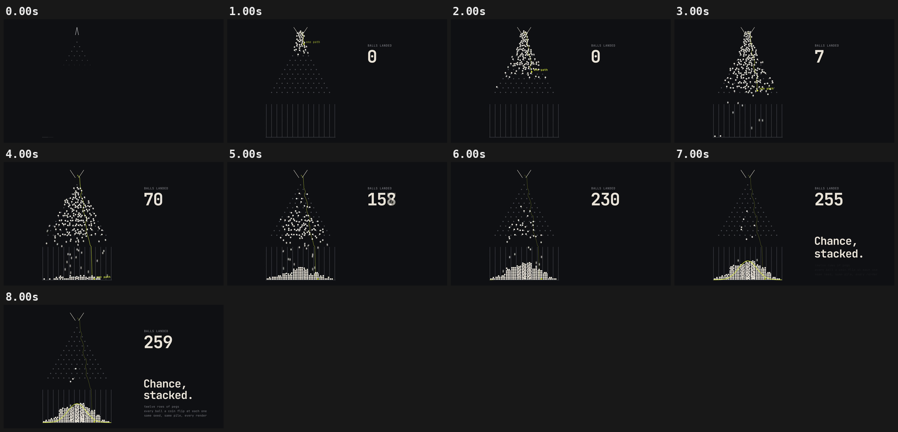

# 02 · CHANCE, STACKED

[](galton-board.mp4)

**[▶ galton-board.mp4](galton-board.mp4)** · 1920×1080 · 8 s · 30 fps · 1.3 MB

## Concept

A Galton board run as a real (if simple) physics simulation: 262 balls fall through twelve rows of pegs and pile up in thirteen bins. The binomial curve is then drawn over the pile, scaled to the measured height. One ball is tracked in acid yellow and leaves its path behind.

- **Typeface:** JetBrains Mono (SIL OFL 1.1, local `../fonts/` subset)
- **Colours:** near-black #111214, bone #E9E4D8, acid #E8FF3A, peg grey
- **Tempo:** 120 BPM (beat = 0.500 s)

## Beat map

| Beat | Time (s) | Event |
|---|---|---|
| b0 | 0.0 | pegs pop in row by row, dividers grow, hopper opens |
| b1 | 0.5 | first ball released; counter appears |
| b2 | 1.0 | tracked ball released, "one path" label rides with it |
| b1–b8 | 0.5–3.5 | stream of balls; counter climbs as balls pass the divider tops |
| b9 | 4.5 | tracked trail starts to fade |
| b12 | 6.0 | binomial curve draws left to right over the bins |
| b13 | 6.5 | "Chance, / stacked." rises (masked), two lines |
| b14 | 7.0 | caption |

## Techniques

- All physics runs once at load with a fixed 1/240 s step: gravity, peg collisions with restitution, slanted walls, per-bin divider constraints, and ball-ball contacts via a uniform grid with four relaxation passes. Positions go into Float32Arrays.
- `seek(t)` only linearly interpolates the recorded positions, so it is pure and seekable in any order, and motion blur subframes are exact.
- Seeded jitter (mulberry32) breaks the symmetry at the first peg, so the pile is the same in every render.
- The landed count and the curve height come from the recorded simulation, not hand-tuned numbers.
- Pure `window.seek(t)`: no `Date`, no `requestAnimationFrame`, no timers, no `Math.random`. `window.ready` is set only after the local font has loaded, and the scene works offline from `file://`.

## Contact sheet



## Render

From this folder, with `R=<frame-motion skill>/scripts/render.py`:

```bash
python3 $R full scene.html galton-board.mp4 --duration 8 --fps 30 --sub 3 --shutter 0.5 --crf 21
python3 $R sheet galton-board.mp4 --every 1 --duration 8 --out contact-sheet.png
python3 $R poster scene.html poster.png --t 7.9
```

Checks:

```bash
python3 $R determinism scene.html --times 2.96,6.48
python3 $R pops galton-board.mp4 --bpm 120
```

## Check results

- `determinism`: seek 2.96 -> 6.48 -> 2.96: max diff 0, mean 0.0000 -> PASS (pixel identical)
- `pops`: 0 spike(s), 0 single-frame flash(es) -> clean; beat sync: 0 on a beat, 0 on a half-beat, 0 off-beat (of 0 spikes, tolerance 4 frames)
