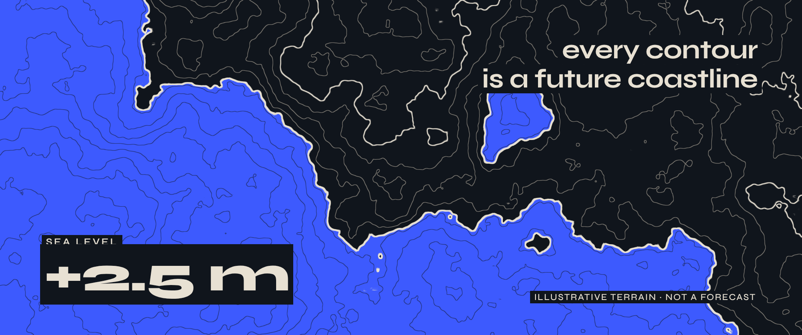
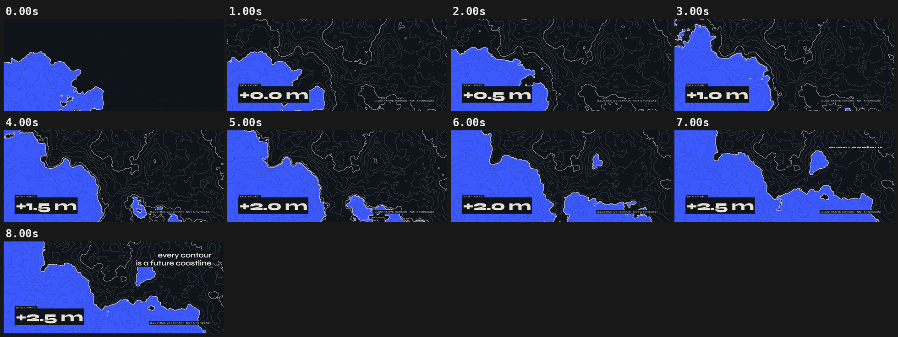

# 03 · RISING CONTOURS

[](rising-contours.mp4)

**[▶ rising-contours.mp4](rising-contours.mp4)** · 1920×804 · 8 s · 30 fps · 4.1 MB

## Concept

A topographic map of an invented coastline, computed per pixel in a fragment shader. The sea level steps up every two beats on a critically damped spring and swallows contour after contour, while the camera drifts sideways. Cinemascope 2.39:1. The terrain is illustrative, not a forecast.

- **Typeface:** Syne (SIL OFL 1.1, local `../fonts/` subset)
- **Colours:** ink #10151C, cream #E8E1D3, cobalt #3D5AFE
- **Tempo:** 96 BPM (beat = 0.625 s)

## Beat map

| Beat | Time (s) | Event |
|---|---|---|
| b0 | 0.0 | contour lines reveal; flat cobalt sea already in place (hook) |
| b1 | 0.6 | "SEA LEVEL" counter and footnote appear |
| b2, b4, b6, b8, b10 | 1.25, 2.5, 3.75, 5.0, 6.25 | the water level steps up one notch each time; the counter ticks on the same beat |
| b11 | 6.9 | "every contour" rises |
| b11.5 | 7.2 | "is a future coastline" rises |

## Techniques

- WebGL2 fragment shader: hash value noise and a six-octave fbm, with contour lines from `fract(h·k)` antialiased by `fwidth`. Every fifth contour is heavier.
- Flat fills only: no gradient or glow. The water is a hard `step(h, L)`, and the shoreline is a distance-in-pixels band using `fwidth(h)`.
- `preserveDrawingBuffer: true` plus `gl.finish()` in `seek`. Render with `--webgl` (SwiftShader) so it is not black headless.
- The non-standard 1920×804 frame uses `--width/--height` on every command.
- Pure `window.seek(t)`: no `Date`, no `requestAnimationFrame`, no timers, no `Math.random`. `window.ready` is set only after the local font has loaded, and the scene works offline from `file://`.

## Contact sheet



## Render

From this folder, with `R=<frame-motion skill>/scripts/render.py`:

```bash
python3 $R full scene.html rising-contours.mp4 --duration 8 --width 1920 --height 804 --webgl --fps 30 --sub 2 --shutter 0.5 --crf 21
python3 $R sheet rising-contours.mp4 --every 1 --duration 8 --out contact-sheet.png
python3 $R poster scene.html poster.png --t 7.9 --width 1920 --height 804 --webgl
```

Checks:

```bash
python3 $R determinism scene.html --times 2.96,6.48 --width 1920 --height 804 --webgl
python3 $R pops rising-contours.mp4 --bpm 96
```

## Check results

- `determinism`: seek 2.96 -> 6.48 -> 2.96: max diff 0, mean 0.0000 -> PASS (pixel identical)
- `pops`: 2 spike(s), 0 single-frame flash(es) -> review those timestamps (intentional beat hits are fine); beat sync: 2 on a beat, 0 on a half-beat, 0 off-beat (of 2 spikes, tolerance 4 frames)
