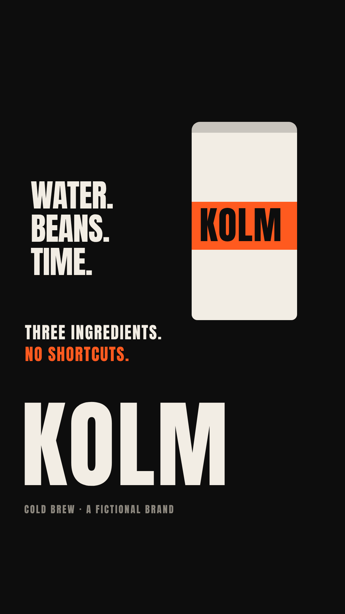
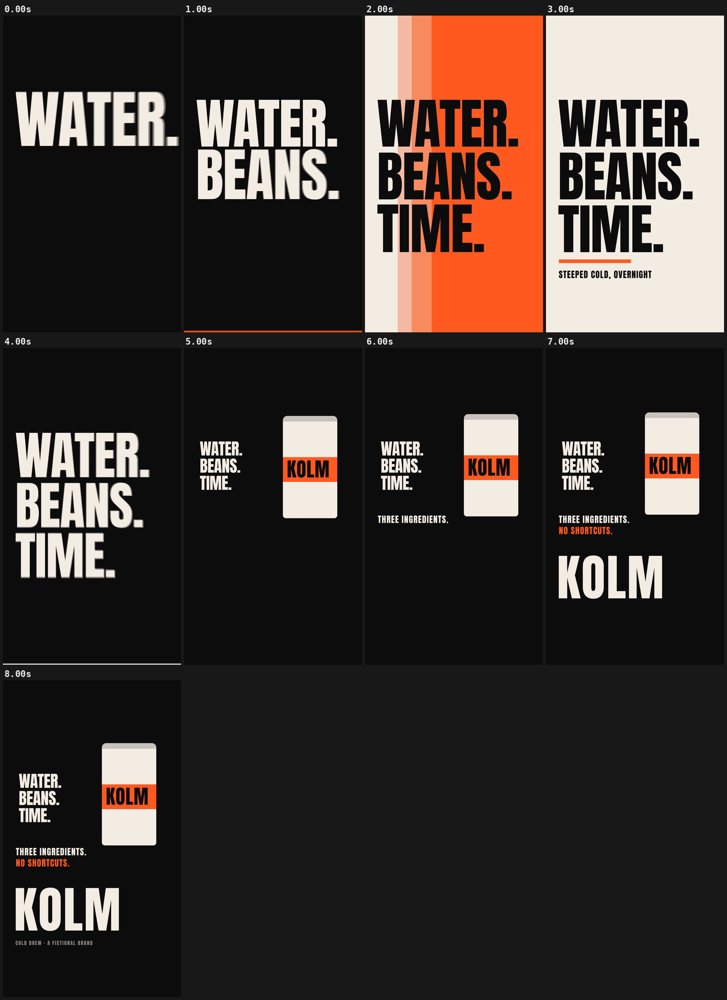

# 04 · KOLM

[](kolm-social-ad.mp4)

**[▶ kolm-social-ad.mp4](kolm-social-ad.mp4)** · 1080×1920 · 8 s · 30 fps · 0.6 MB · with sound (−14 LUFS)

## Concept

A vertical 9:16 social ad for **KOLM, a fictional cold-brew brand**. Three huge words slam in on the beat while hard-edged colour panels wipe underneath. Then the same three words shrink into a stack beside the can (a persistent-object handoff) and the brand mark lands. It has a coded soundtrack at the same BPM, muxed to −14 LUFS.

- **Typeface:** Anton (SIL OFL 1.1, local `../fonts/` subset)
- **Colours:** black #0D0D0D, bone #F2EDE4, orange #FF5A1F
- **Tempo:** 128 BPM (beat = 0.469 s)

## Beat map

| Beat | Time (s) | Event |
|---|---|---|
| b0 | 0.00 | WATER. slams in on black (kick + hit) |
| b2 | 0.94 | orange panel wipes up; BEANS. slams in (hit) |
| b4 | 1.88 | bone panel wipes across; TIME. slams in (hit) |
| b5–b8 | 2.34–3.75 | orange "time" bar fills under the words; riser builds |
| b6 | 2.81 | STEEPED COLD, OVERNIGHT |
| b8 | 3.75 | black wipe from the top; the three words shrink into a stack (hit) |
| b9 | 4.22 | the can rises (hit) |
| b12, b13 | 5.63, 6.09 | THREE INGREDIENTS. / NO SHORTCUTS. |
| b14 | 6.56 | KOLM brand mark lands, tracking closes (hit) |
| b15 | 7.03 | "COLD BREW · A FICTIONAL BRAND" |

## Techniques

- Each word exists twice: a bone copy, and a black copy clipped to the light panels. Ink colour follows the panel under each pixel, even mid-wipe, with no colour pop.
- Panel wipes are `clip-path: inset()` driven by `expoInOut` over 0.6 beats. The words use stiff critically damped springs (scale 1.18 → 1, no overshoot).
- `soundtrack.html` is adapted from the skill's `examples/audio-template.html`: kick on every beat, F1 bass per bar, hits at the slam times, and a riser into b8. It is rendered offline with `audio render` and muxed with `mux --lufs -14`.
- Pure `window.seek(t)`: no `Date`, no `requestAnimationFrame`, no timers, no `Math.random`. `window.ready` is set only after the local font has loaded, and the scene works offline from `file://`.

## Contact sheet



## Render

From this folder, with `R=<frame-motion skill>/scripts/render.py`:

```bash
python3 $R full scene.html silent.mp4 --duration 8 --preset 9:16 --fps 30 --sub 3 --shutter 0.5 --crf 22
python3 $R audio render soundtrack.html soundtrack.wav --duration 8
python3 $R mux silent.mp4 soundtrack.wav kolm-social-ad.mp4 --lufs -14
python3 $R sheet kolm-social-ad.mp4 --every 1 --duration 8 --out contact-sheet.png
python3 $R poster scene.html poster.png --t 7.9 --preset 9:16
```

Checks:

```bash
python3 $R determinism scene.html --times 2.96,6.48 --preset 9:16
python3 $R pops kolm-social-ad.mp4 --bpm 128
```

## Check results

- `determinism`: seek 2.96 -> 6.48 -> 2.96: max diff 0, mean 0.0000 -> PASS (pixel identical)
- `pops`: 9 spike(s), 0 single-frame flash(es) -> review those timestamps (intentional beat hits are fine); beat sync: 4 on a beat, 5 on a half-beat, 0 off-beat (of 9 spikes, tolerance 4 frames)
- Loudness (ffmpeg ebur128 on the final MP4): integrated -14.0 LUFS, true peak -1.2 dBFS
