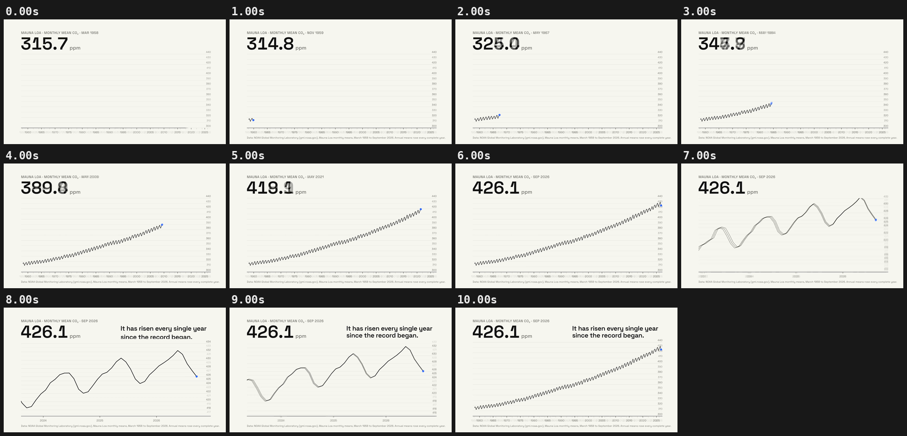

# 05 · THE LINE THAT ONLY CLIMBS

[](keeling-chart-story.mp4)

**[▶ keeling-chart-story.mp4](keeling-chart-story.mp4)** · 1920×1080 · 10 s · 30 fps · 1.4 MB

## Concept

An animated chart story with **real data**: NOAA's Mauna Loa monthly mean CO₂ draws month by month from 1958 to September 2026, with the big number always showing the month under the pen. The camera then zooms (in log space) into the last three years to reveal the seasonal sawtooth, and pulls back out. The closing claim is checked against the data: the annual mean rose in every complete year of the record.

Data: NOAA Global Monitoring Laboratory, Mauna Loa CO₂ monthly mean (co2_mm_mlo.csv, <https://gml.noaa.gov/ccgg/trends/>), pulled 2026-10-19; freely available U.S. Government work (Scripps Institution of Oceanography before May 1974).

- **Typeface:** Space Grotesk (SIL OFL 1.1, local `../fonts/` subset)
- **Colours:** off-white #F7F7F2, ink #121212, blue #2F6BFF, grey
- **Tempo:** 100 BPM (beat = 0.600 s)

## Beat map

| Beat | Time (s) | Event |
|---|---|---|
| b0 | 0.0 | axis and big number are already on screen (hook) |
| b1–b10 | 0.6–6.0 | line draws month by month; number and month tick with it |
| b10 | 6.0 | zoom into the last three years begins (log-space window) |
| b12.5, b13 | 7.5, 7.8 | "It has risen every single year / since the record began." |
| b14.5 | 8.7 | pull back to the full record |
| b16.5 | 9.9 | end on the full curve |

## Techniques

- The data is embedded in the HTML (823 months from the same NOAA snapshot as data-dash example 01), so the scene runs offline.
- The view window is interpolated in log space for width and linearly for centre, so the zoom feels constant.
- Multi-level axis ticks (1/2/5/10/20) fade in by their on-screen spacing, so labels never pop during the zoom.
- Everything is projected to screen coordinates inside `seek`, so stroke widths stay crisp at any zoom.
- Pure `window.seek(t)`: no `Date`, no `requestAnimationFrame`, no timers, no `Math.random`. `window.ready` is set only after the local font has loaded, and the scene works offline from `file://`.

## Contact sheet



## Render

From this folder, with `R=<frame-motion skill>/scripts/render.py`:

```bash
python3 $R full scene.html keeling-chart-story.mp4 --duration 10 --fps 30 --sub 3 --shutter 0.5 --crf 21
python3 $R sheet keeling-chart-story.mp4 --every 1 --duration 10 --out contact-sheet.png
python3 $R poster scene.html poster.png --t 9.9
```

Checks:

```bash
python3 $R determinism scene.html --times 3.70,8.10
python3 $R pops keeling-chart-story.mp4 --bpm 100
```

## Check results

- `determinism`: seek 3.7 -> 8.1 -> 3.7: max diff 0, mean 0.0000 -> PASS (pixel identical)
- `pops`: 0 spike(s), 0 single-frame flash(es) -> clean; beat sync: 0 on a beat, 0 on a half-beat, 0 off-beat (of 0 spikes, tolerance 4 frames)
