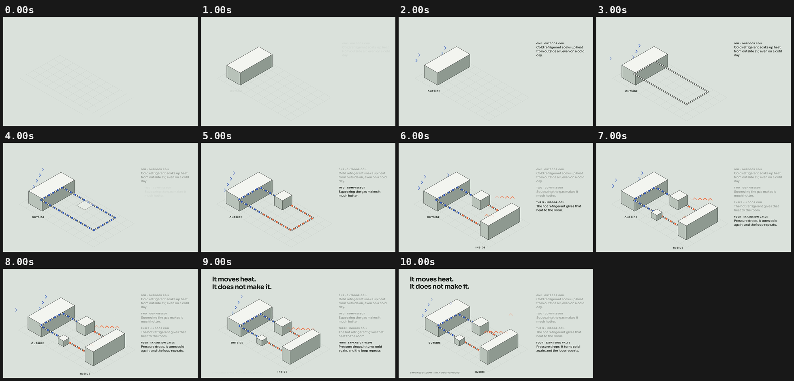

# 06 · MOVES HEAT

[](heat-pump-isometric.mp4)

**[▶ heat-pump-isometric.mp4](heat-pump-isometric.mp4)** · 1920×1080 · 10 s · 30 fps · 1.0 MB

## Concept

An isometric explainer of how a heat pump works in four steps (outdoor coil, compressor, indoor coil, expansion valve), with refrigerant beads flowing round one pipe loop and changing from cold to hot at the compressor. A simplified, generic diagram, not a specific product.

- **Typeface:** Sora (SIL OFL 1.1, local `../fonts/` subset)
- **Colours:** sage #DDE3DD with ink tints, blue #2B59C3 (cold), orange #F26B38 (hot)
- **Tempo:** 90 BPM (beat = 0.667 s)

## Beat map

| Beat | Time (s) | Event |
|---|---|---|
| b0 | 0.0 | isometric ground grid draws |
| b0.5 | 0.33 | outdoor coil rises; step one |
| b2 | 1.33 | cold air chevrons flow into the coil |
| b3–b5 | 2.0–3.33 | pipe loop draws |
| b4.5 | 3.0 | beads start flowing (speed ramps up) |
| b6 | 4.0 | compressor rises; step two; beads turn orange after it |
| b8 | 5.33 | indoor coil rises; step three; heat chevrons rise into the room |
| b10 | 6.67 | expansion valve; step four; beads turn blue again |
| b12 | 8.0 | camera eases back |
| b12.5, b13 | 8.33, 8.67 | "It moves heat. / It does not make it." |

## Techniques

- A tiny isometric engine: `iso(x, y, z)`, with boxes as three flat-shaded faces (tints of one ink) plus outlines, all in SVG.
- Bead positions are closed form. Phase is the integral of an exponentially ramping speed, so `seek` stays pure with no accumulated state.
- Hot/cold is decided by arc length along the loop (between the compressor and valve positions).
- The step list builds, and earlier steps dim to grey, so the current step is always obvious.
- Pure `window.seek(t)`: no `Date`, no `requestAnimationFrame`, no timers, no `Math.random`. `window.ready` is set only after the local font has loaded, and the scene works offline from `file://`.

## Contact sheet



## Render

From this folder, with `R=<frame-motion skill>/scripts/render.py`:

```bash
python3 $R full scene.html heat-pump-isometric.mp4 --duration 10 --fps 30 --sub 2 --shutter 0.5 --crf 21
python3 $R sheet heat-pump-isometric.mp4 --every 1 --duration 10 --out contact-sheet.png
python3 $R poster scene.html poster.png --t 9.9
```

Checks:

```bash
python3 $R determinism scene.html --times 3.70,8.10
python3 $R pops heat-pump-isometric.mp4 --bpm 90
```

## Check results

- `determinism`: seek 3.7 -> 8.1 -> 3.7: max diff 0, mean 0.0000 -> PASS (pixel identical)
- `pops`: 0 spike(s), 0 single-frame flash(es) -> clean; beat sync: 0 on a beat, 0 on a half-beat, 0 off-beat (of 0 spikes, tolerance 4 frames)
