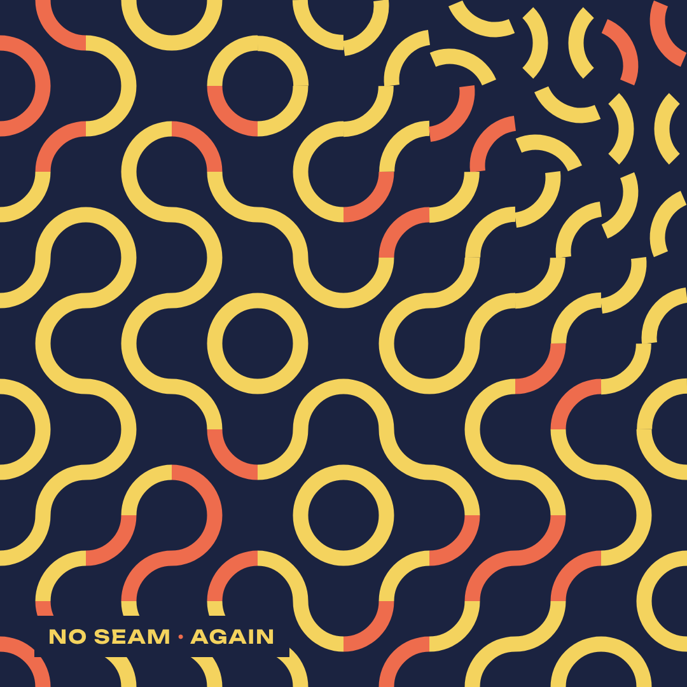
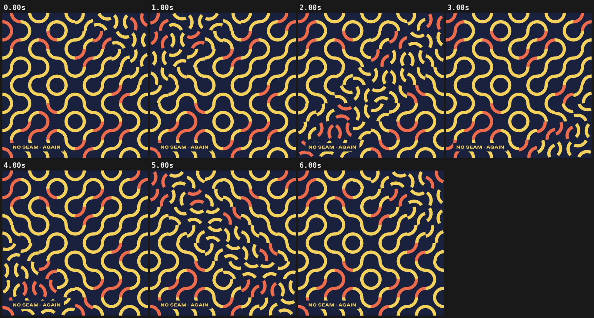

# 07 · NO SEAM

[](truchet-loop.mp4)

**[▶ truchet-loop.mp4](truchet-loop.mp4)** · 1080×1080 · 6 s · 30 fps · 1.4 MB

## Concept

A loop-perfect 1:1 piece. A seeded 8×8 Truchet field of quarter-circle tiles is swept by two diagonal waves per loop, travelling in opposite directions. Each wave turns every tile by 90°, so after both waves each tile has turned 180°, which maps a Truchet tile onto itself. The last frame equals the first.

- **Typeface:** Unbounded (SIL OFL 1.1, local `../fonts/` subset)
- **Colours:** navy #1B2340, yellow #F4D35E, coral #EE6C4D
- **Tempo:** 120 BPM (beat = 0.500 s)

## Beat map

| Beat | Time (s) | Event |
|---|---|---|
| b0 | 0.0 | wave one leaves the top-left corner |
| b0–b5 | 0.0–2.6 | wave one sweeps to the bottom-right |
| b6 | 3.0 | wave two leaves the bottom-left corner |
| b6–b11 | 3.0–5.6 | wave two sweeps to the top-right |
| b12 = b0 | 6.0 | seam: identical frame, identical velocity |

## Techniques

- Every motion is a function of the loop phase `(t / D) mod 1`, never of absolute time, so position and velocity match at the seam.
- The step function is the quintic smoothstep (zero velocity at both ends), so tiles at rest have zero speed and nothing jumps.
- Canvas 2D, redrawn from scratch each frame; tile orientations and colours come from a seeded table built once.
- The static label is the only text, to keep the loop clean.
- Pure `window.seek(t)`: no `Date`, no `requestAnimationFrame`, no timers, no `Math.random`. `window.ready` is set only after the local font has loaded, and the scene works offline from `file://`.

## Contact sheet



## Render

From this folder, with `R=<frame-motion skill>/scripts/render.py`:

```bash
python3 $R full scene.html truchet-loop.mp4 --duration 6 --preset 1:1 --fps 30 --sub 3 --shutter 0.5 --crf 22
python3 $R sheet truchet-loop.mp4 --every 1 --duration 6 --out contact-sheet.png
python3 $R poster scene.html poster.png --t 0 --preset 1:1
```

Checks:

```bash
python3 $R determinism scene.html --times 2.22,4.86 --preset 1:1
python3 $R pops truchet-loop.mp4 --bpm 120
python3 $R loop scene.html --duration 6 --fps 30 --preset 1:1
```

## Check results

- `determinism`: seek 2.22 -> 4.86 -> 2.22: max diff 0, mean 0.0000 -> PASS (pixel identical)
- `pops`: 7 spike(s), 0 single-frame flash(es) -> review those timestamps (intentional beat hits are fine); beat sync: 4 on a beat, 3 on a half-beat, 0 off-beat (of 7 spikes, tolerance 4 frames)
- `loop`: loop: frame 0 vs t=6.0s  mean diff 0.000  max 0  -> PASS (tol 0.5)
- `loop`: velocity: first step 0.996  last step 1.483  ratio 1.49 -> PASS (max ratio 1.5)
