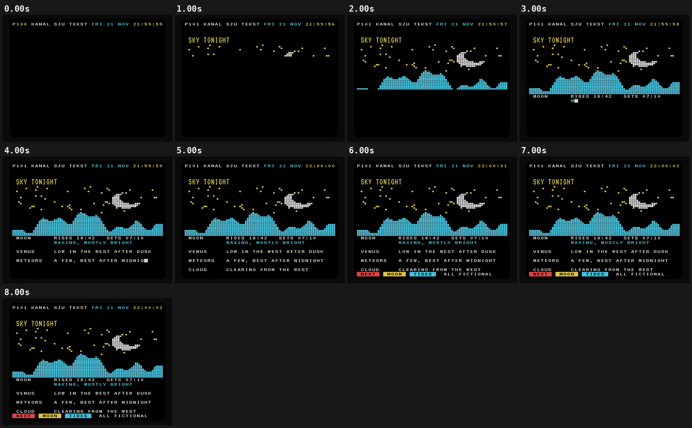

# 08 · PAGE 101

[](teletext-sky.mp4)

**[▶ teletext-sky.mp4](teletext-sky.mp4)** · 1440×1080 · 8 s · 30 fps · 0.1 MB

## Concept

Retro teletext on a CRT. A **fictional** service, "Kanal Sju Tekst", searches for page 101, builds a mosaic-graphics night sky row by row, and types in tonight's sky listings. Everything sits on a strict 40×25 character grid. All names, times and forecasts are invented.

- **Typeface:** VT323 (SIL OFL 1.1, local `../fonts/` subset)
- **Colours:** black, white, yellow #FFE14D, cyan #4DE1FF, red #FF4D4D (cut from the teletext set to three colours)
- **Tempo:** 120 BPM (beat = 0.500 s)

## Beat map

| Beat | Time (s) | Event |
|---|---|---|
| b0 | 0.0 | header with page search P1xx and ticking clock |
| b1 | 0.5 | page 101 found: double-height title appears |
| b1.25–b4.25 | 0.6–2.1 | mosaic sky builds sixel row by sixel row |
| b5 | 2.5 | listings start typing behind a block cursor |
| b12 | 6.0 | fastext row with coloured keys |
| b14–b16 | 7.0–8.0 | page complete; clock keeps ticking |

## Techniques

- One canvas. Each glyph is placed in its own teletext cell and stretched horizontally (VT323 is narrow), with true double-height for the title.
- Mosaic graphics are drawn as 2×3 "sixel" blocks from a bitmap built once: moon, ridge and seeded stars.
- The CRT look is drawn scanlines plus a rounded screen mask. No blur, glow, curvature or RGB split.
- Rendered without motion blur (`--sub 1`): teletext updates are hard by nature, and every hard change lands on a beat.
- Pure `window.seek(t)`: no `Date`, no `requestAnimationFrame`, no timers, no `Math.random`. `window.ready` is set only after the local font has loaded, and the scene works offline from `file://`.

## Contact sheet



## Render

From this folder, with `R=<frame-motion skill>/scripts/render.py`:

```bash
python3 $R full scene.html teletext-sky.mp4 --duration 8 --width 1440 --height 1080 --fps 30 --crf 22
python3 $R sheet teletext-sky.mp4 --every 1 --duration 8 --out contact-sheet.png
python3 $R poster scene.html poster.png --t 7.9 --width 1440 --height 1080
```

Checks:

```bash
python3 $R determinism scene.html --times 2.96,6.48 --width 1440 --height 1080
python3 $R pops teletext-sky.mp4 --bpm 120
```

## Check results

- `determinism`: seek 2.96 -> 6.48 -> 2.96: max diff 0, mean 0.0000 -> PASS (pixel identical)
- `pops`: 1 spike(s), 0 single-frame flash(es) -> review those timestamps (intentional beat hits are fine); beat sync: 1 on a beat, 0 on a half-beat, 0 off-beat (of 1 spikes, tolerance 4 frames)
