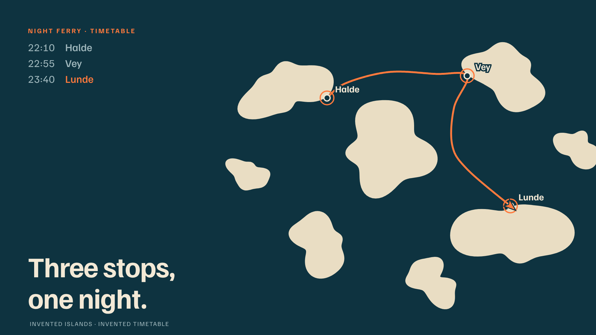
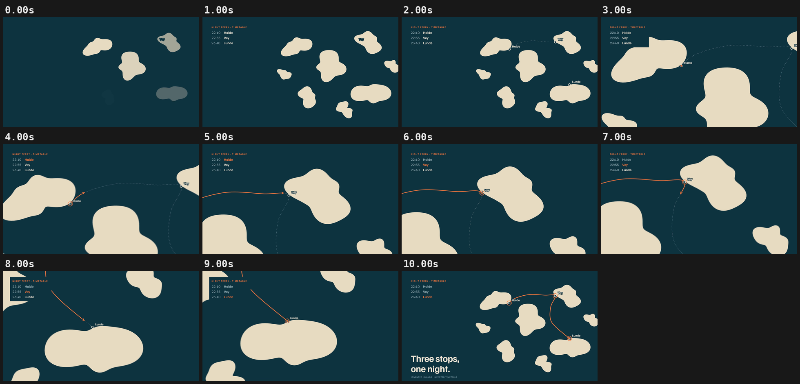

# 09 · NIGHT FERRY

[](night-ferry-route.mp4)

**[▶ night-ferry-route.mp4](night-ferry-route.mp4)** · 1920×1080 · 10 s · 30 fps · 1.1 MB

## Concept

A map/route animation over a **fictional** archipelago. The camera dives from the overview to the harbour, follows the night ferry through the channels to two more stops, and pulls back out to show the whole route. Islands, ports and timetable are invented.

- **Typeface:** Familjen Grotesk (SIL OFL 1.1, local `../fonts/` subset)
- **Colours:** deep teal #0E3340, sand #E9DDC3, orange #FF7A3D
- **Tempo:** 96 BPM (beat = 0.625 s)

## Beat map

| Beat | Time (s) | Event |
|---|---|---|
| b0 | 0.0 | islands surface, staggered |
| b0.5–b1 | 0.3–0.6 | timetable panel builds |
| b2 | 1.25 | ports pop with names |
| b2.5–b4 | 1.6–2.5 | planned route draws as dots |
| b3.5–b5 | 2.2–3.1 | camera dives to Halde (log-space zoom) |
| b5–b9 | 3.1–5.6 | leg one to Vey; travelled route turns solid orange |
| b9 | 5.6 | Vey reached: orange ring, timetable row lights |
| b10–b14 | 6.25–8.75 | leg two to Lunde |
| b14 | 8.75 | camera pulls back out |
| b14.5, b15 | 9.1, 9.4 | "Three stops, / one night." |

## Techniques

- Islands are seeded noise-perturbed circles. Ports snap to the nearest shore point, and a load-time self-check confirms the route never crosses land.
- The route is a Catmull-Rom spline through channel waypoints, resampled by arc length, so the ferry speed is honest and easing is applied to distance.
- The camera follows the ferry with a dive/out blend. Zoom is interpolated in log space, and everything is projected to screen space each frame, so labels and strokes stay crisp.
- The ferry arrowhead is aligned to the route tangent, taken from the same pure position function.
- Pure `window.seek(t)`: no `Date`, no `requestAnimationFrame`, no timers, no `Math.random`. `window.ready` is set only after the local font has loaded, and the scene works offline from `file://`.

## Contact sheet



## Render

From this folder, with `R=<frame-motion skill>/scripts/render.py`:

```bash
python3 $R full scene.html night-ferry-route.mp4 --duration 10 --fps 30 --sub 3 --shutter 0.5 --crf 21
python3 $R sheet night-ferry-route.mp4 --every 1 --duration 10 --out contact-sheet.png
python3 $R poster scene.html poster.png --t 9.9
```

Checks:

```bash
python3 $R determinism scene.html --times 3.70,8.10
python3 $R pops night-ferry-route.mp4 --bpm 96
```

## Check results

- `determinism`: seek 3.7 -> 8.1 -> 3.7: max diff 0, mean 0.0000 -> PASS (pixel identical)
- `pops`: 0 spike(s), 0 single-frame flash(es) -> clean; beat sync: 0 on a beat, 0 on a half-beat, 0 off-beat (of 0 spikes, tolerance 4 frames)
