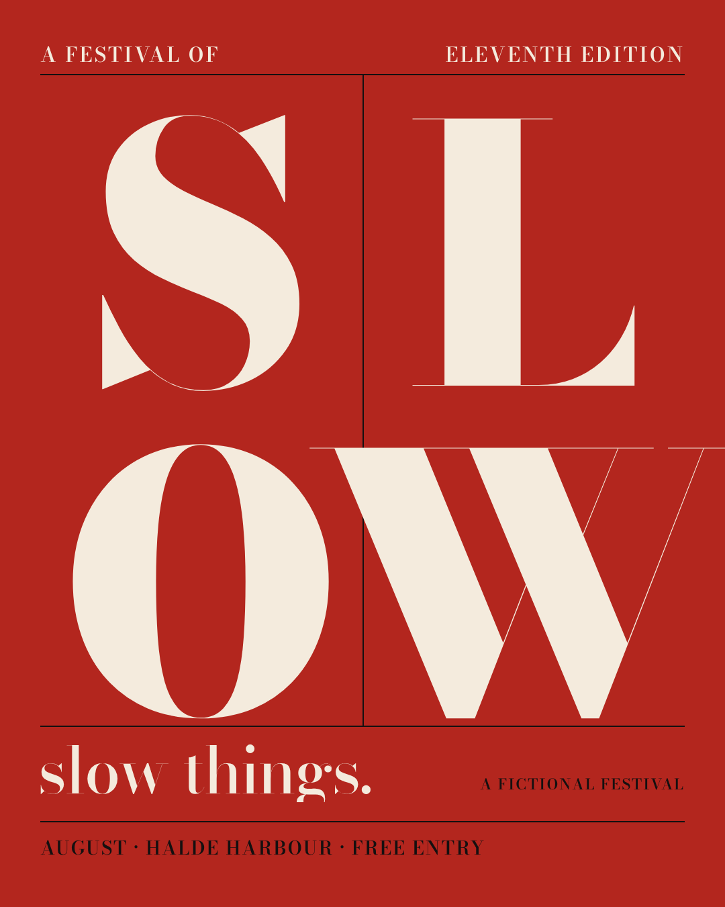
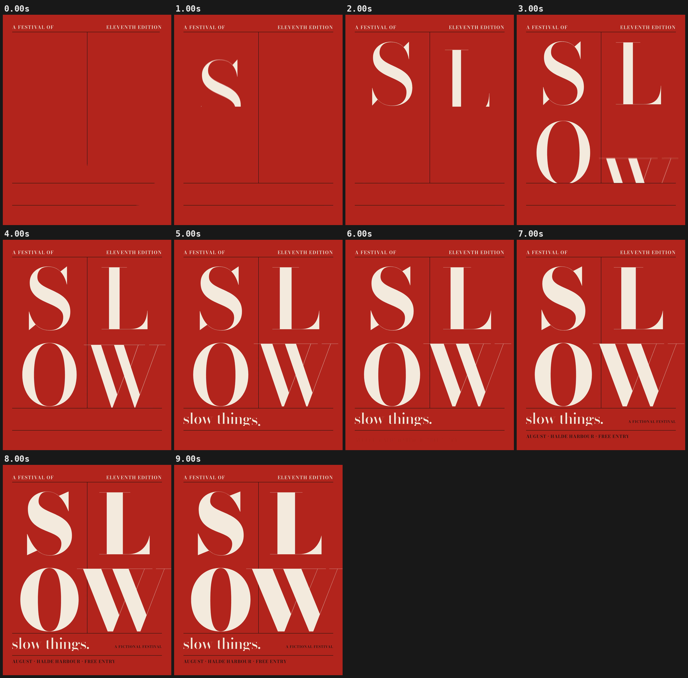

# 10 · SLOW

[](slow-poster.mp4)

**[▶ slow-poster.mp4](slow-poster.mp4)** · 1080×1350 · 9 s · 30 fps · 0.4 MB

## Concept

A typographic poster in motion (4:5) for **a fictional festival of slow things**. The four giant letters of SLOW arrive one per beat on deliberately soft springs, and keep gaining weight on the variable `wght` axis for the whole piece. Every small line snaps in fast on its beat: slow against quick.

- **Typeface:** Bodoni Moda (SIL OFL 1.1, local `../fonts/` subset)
- **Colours:** red #B3261E, cream #F4EBDD, black #141010
- **Tempo:** 80 BPM (beat = 0.750 s)

## Beat map

| Beat | Time (s) | Event |
|---|---|---|
| b0 | 0.0 | hairline poster grid and top labels are already landing (hook) |
| b0.5, b1.5, b2.5, b3.5 | 0.38, 1.13, 1.88, 2.63 | S, L, O, W rise on soft critically damped springs (w = 4.5) |
| b0.5–end | 0.38–9.0 | each letter's weight climbs from 400 to 900 |
| b6 | 4.5 | "slow things." snaps in letter by letter (stiff spring) |
| b8, b9 | 6.0, 6.75 | date/venue line, then "A FICTIONAL FESTIVAL" |

## Techniques

- A variable font (Bodoni Moda: `wght` 400–900, `opsz` 6–96) is animated through `font-variation-settings`. The big letters use optical size 96 and the small text optical size 11.
- The same critically damped spring is used throughout; only the stiffness changes. Soft for the giant letters, stiff for the small type, which gives the slow/quick contrast without any overshoot.
- Masks are `clip-path` boxes on each cell, with horizontal overflow allowed so the heavy W can bleed across the grid line.
- Pure `window.seek(t)`: no `Date`, no `requestAnimationFrame`, no timers, no `Math.random`. `window.ready` is set only after the local font has loaded, and the scene works offline from `file://`.

## Contact sheet



## Render

From this folder, with `R=<frame-motion skill>/scripts/render.py`:

```bash
python3 $R full scene.html slow-poster.mp4 --duration 9 --preset 4:5 --fps 30 --sub 3 --shutter 0.5 --crf 21
python3 $R sheet slow-poster.mp4 --every 1 --duration 9 --out contact-sheet.png
python3 $R poster scene.html poster.png --t 8.95 --preset 4:5
```

Checks:

```bash
python3 $R determinism scene.html --times 3.33,7.29 --preset 4:5
python3 $R pops slow-poster.mp4 --bpm 80
```

## Check results

- `determinism`: seek 3.33 -> 7.29 -> 3.33: max diff 0, mean 0.0000 -> PASS (pixel identical)
- `pops`: 0 spike(s), 0 single-frame flash(es) -> clean; beat sync: 0 on a beat, 0 on a half-beat, 0 off-beat (of 0 spikes, tolerance 4 frames)
